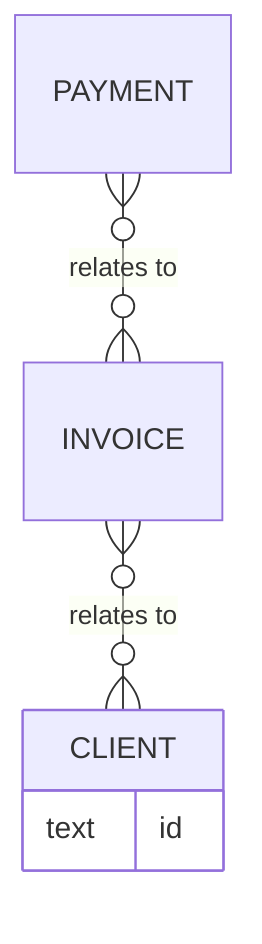

# Product rebuild specification: ledgerly.example

What a team would need to rebuild the behaviour of ledgerly.example: scope, features with acceptance criteria,
user stories, screens, roles and permissions, data model, business rules, plans and integrations.
It describes behaviour seen in normal use and public documentation; it copies no code, design or content.

## Report details

| | |
| --- | --- |
| Subject | ledgerly.example (https://ledgerly.example) |
| Report | Product rebuild specification |
| Analysis run | ledgerly-example-2026-10-14 |
| Date | 2026-10-14 |
| Evidence base | 4 sources, 72 evidence records (0 observed, 1 provided, 54 documented, 17 inferred, 0 unknown) |
| Overall confidence | **High** (83 of 100): 33 evidence records behind 32 items shown (32 with evidence), weighted by label, minus 0 points for 0 unmet section needs |

## Scope and methodology

- **Subject**: ledgerly.example, analysed as a fintech business.
- **Focus questions**: "What are the biggest risks?".
- **Sources**: public pages read one at a time (obeying robots.txt), each recorded with its address, date read and a fingerprint of its content; documents the business handed over.
- **Period**: evidence collected from 2026-10-14 to 2026-10-14.
- **Evidence labels**: every finding is labelled **observed** (seen in the analyst's own use of the product), **provided** (from a document the business handed over), **documented** (stated publicly), **inferred** (a reasoned judgement) and **unknown** (not confirmed). Ids in [brackets] cite knowledge-graph items (kb/nodes/<id>.md) and evidence (E-) or source (S-) records (evidence/ledger.jsonl).
- **Boundaries**: normal use only. reb never logs in to the product for the analyst, never calls its private interfaces, never replays or alters requests, never scrapes and never automates clicks.

## Product overview and scope

_What the product is, its areas and who uses it._

### Product (1)

- **Ledgerly** (documented): Has: Invoicing, Payments. Delivers: Get paid in one click, No more chasing late payers. Exposes: List invoices. Made by: Ledgerly Labs. Bought by: Example Studio. Measured by: Customers mid 2026. Built with: React. Threatened by: Card data breach. Findings about it: Fast onboarding. Affected by: E-invoicing mandates. [product-ledgerly, E-002, E-072]
  - documented: Ledgerly: as read on the public pages. [E-002, S-001]
  - provided: Document pitch-deck.pdf about Ledgerly, provided by the business. Limits: From a document the business handed over; not checked against public sources. [E-072, S-004]

### Modules (2)

- **Invoicing** (documented): Has: Send invoice, Recurring invoices, Payment reminders. Part of: Ledgerly. [module-invoicing, E-003]
  - documented: Invoicing: as read on the public pages. [E-003, S-001]
- **Payments** (documented): Has: Card payments, Bank reconciliation. Part of: Ledgerly. [module-payments, E-004]
  - documented: Payments: as read on the public pages. [E-004, S-001]

### Personas (1)

- **Freelancer** (documented): Does: Get paid, Chase a late invoice. Belongs to: Freelancers and small agencies. Served by: Get paid in one click. [persona-freelancer, E-013]
  - documented: Freelancer: as read on the public pages. [E-013, S-001]

## Features and acceptance criteria

_Every feature, with the criteria a rebuilt version must meet._

### Features (5)

- **Bank reconciliation** (documented): Available on: Pro. Connects to: Xero. Part of: Payments. Usable by: Accountant. [feature-bank-reconciliation, E-009]
  - documented: Bank reconciliation: as read on the public pages. [E-009, S-001]
- **Card payments** (documented): Available on: Free. Part of: Payments. Used in: Get paid. Built with: Stripe. Threatened by: One payment processor. Usable by: Owner. [feature-card-payments, E-008]
  - documented: Card payments: as read on the public pages. [E-008, S-001]
- **Payment reminders** (documented): Available on: Free. Part of: Invoicing. Used in: Chase a late invoice. Governed by: Reminders after 7 days. [feature-payment-reminders, E-007]
  - documented: Payment reminders: as read on the public pages. [E-007, S-001]
- **Recurring invoices** (documented): Available on: Pro. Part of: Invoicing. [feature-recurring-invoices, E-006]
  - documented: Recurring invoices: as read on the public pages. [E-006, S-001]
- **Send invoice** (documented): Available on: Free. Reads and writes: Invoice. Part of: Invoicing. Used in: Get paid. Also offered by: Billbird. Shown on: Invoices. Acceptance: The customer gets an email with a pay link. [feature-send-invoice, E-005]
  - documented: Send invoice: as read on the public pages. [E-005, S-001]

## User stories

_One story per persona and journey, step by step._

### User stories

- **US-1** As a Freelancer, I want to get paid. [persona-freelancer, E-013, journey-get-paid, E-014]
  - Step 1: Send invoice [feature-send-invoice, E-005]
    - Accept: The customer gets an email with a pay link [feature-send-invoice]
  - Step 2: Card payments [feature-card-payments, E-008]
- **US-2** As a Freelancer, I want to chase a late invoice. [persona-freelancer, E-013, journey-chase-a-late-invoice, E-015]
  - Step 1: Payment reminders [feature-payment-reminders, E-007]

## Screens and navigation

_The screens, how they lead to each other and what each shows._

### Screens and navigation

- **Billing settings** `/settings/billing`: shows Payment [screen-billing-settings, E-061]
- **Dashboard** `/` [screen-dashboard, E-057]
  - **Invoices** `/invoices`: shows Send invoice [screen-invoices, E-058]
    - **New invoice** `/invoices/new` [screen-new-invoice, E-059]
  - **Clients** `/clients` [screen-clients, E-060]

## Roles and permissions

_The user roles inside the product and what each may use._

### Roles and permissions

| Feature or screen | Accountant | Owner | Cites |
| --- | --- | --- | --- |
| Bank reconciliation | yes |  | [feature-bank-reconciliation, E-009] |
| Card payments |  | yes | [feature-card-payments, E-008] |
| Billing settings |  | yes | [screen-billing-settings, E-061] |

Roles: Accountant [user_role-accountant, E-063]; Owner [user_role-owner, E-062]. An empty cell means no evidence was recorded.

## Data model

_The data objects with their fields, states and relations._

### Data model

- **Client**: fields not recorded. [data_object-client, E-068]
- **Invoice**: fields not recorded; states: draft -> sent -> paid; relates to Client; used by List invoices, Send invoice. [data_object-invoice, E-067]
- **Payment**: fields not recorded; relates to Invoice. [data_object-payment, E-069]

## Business rules and limits

_Rules, limits and validations the product applies._

### Business rules and limits

| Rule | Kind | Governs | Cites |
| --- | --- | --- | --- |
| Five invoices a month on Free | limit | Free | [business_rule-five-invoices-a-month-on-free, E-064] |
| Invoice numbers never repeat | validation | Invoice | [business_rule-invoice-numbers-never-repeat, E-065] |
| Reminders after 7 days | workflow | Payment reminders | [business_rule-reminders-after-7-days, E-066] |

## Plans and entitlements

_The pricing plans and what each one unlocks._

### Plans (2)

- **Free** (documented): Unlocks: Card payments, Payment reminders, Send invoice. Governed by: Five invoices a month on Free. [pricing_tier-free, E-010]
  - documented: Free: as read on the public pages. [E-010, S-001]
- **Pro** (documented): Unlocks: Bank reconciliation, Recurring invoices. [pricing_tier-pro, E-011]
  - documented: Pro: as read on the public pages. [E-011, S-001]

## Integrations and public API

_Outside services to connect to, and the public API to offer._

### Public API

| Method | Path | What it does | Data | Cites |
| --- | --- | --- | --- | --- |
| GET | `/v1/invoices` | List invoices | Invoice | [api_endpoint-list-invoices, E-070] |

### Integrations (1)

- **Xero** (documented): Used by: Bank reconciliation. [integration-xero, E-012]
  - documented: Xero: as read on the public pages. [E-012, S-001]

## Technology notes

_What the product is likely built with, as a starting point._

### Technology stack

| Part of the stack | Technology | Label | Powers | Cites |
| --- | --- | --- | --- | --- |
| Frontend | React | documented | Ledgerly | [technology-react, E-054] |
| Database | PostgreSQL | inferred |  | [technology-postgresql, E-055] |
| Payments | Stripe | documented | Card payments | [technology-stripe, E-056] |

### Hypotheses (1)

- **Invoices and payments live in one database** (inferred): Explains: Payment. [hypothesis-invoices-and-payments-live-in-one-database, E-071]
  - inferred: Invoices and payments live in one database: as read on the public pages. [E-071, S-001]

## Limitations and disclaimer

The main limits of the evidence behind this report:

- From a document the business handed over; not checked against public sources. (1 record)

6% of the evidence behind this report is inferred or unconfirmed; those points are judgements, not facts. This report is based on public information, documents the business provided. It is not an audit opinion, legal advice or investment advice. Facts may have changed since the dates given. Check the cited sources before relying on any single point.

## Sources

- **S-001** Ledgerly home page, Ledgerly Labs. https://ledgerly.example (published 2026-09-01; read 2026-10-14)
- **S-004** Document pitch-deck.pdf (provided), the analysed business (provided document). evidence/inbox/provided/pitch-deck.pdf (read 2026-10-14)

## Open questions

No open questions.
